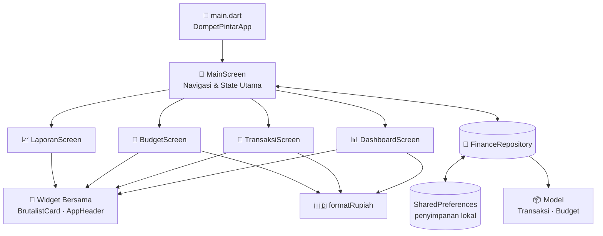

<div align="center">

# 👛 Dompet Pintar

**Aplikasi manajemen keuangan pribadi dengan antarmuka _Neo-Brutalist_ yang tegas, berani, dan anti-membosankan.**


[Fitur](#-fitur-utama) • [Desain](#-desain-antarmuka) • [Memulai](#-memulai-proyek) • [Arsitektur](#-arsitektur-aplikasi) • [Struktur](#-struktur-direktori) • [Roadmap](#-rencana-pengembangan)

</div>

---

## 📖 Tentang Proyek

**Dompet Pintar** membantu pengguna mencatat transaksi harian, memantau batas anggaran per kategori, dan melihat tren pengeluaran dalam satu aplikasi yang ringan. Seluruh data tersimpan **langsung di perangkat**, sehingga aplikasi bisa dipakai tanpa akun dan tanpa koneksi internet.

Tampilannya memakai gaya **Neo-Brutalism**: border hitam tebal, bayangan keras tanpa blur, dan warna pastel kontras.

## ✨ Fitur Utama

### 📊 Dashboard
* **Kartu Total Saldo:** Saldo disembunyikan secara bawaan demi privasi. Ketuk ikon mata atau tekan lama pada saldo untuk menampilkannya.
* **Ringkasan Arus Kas:** Kartu terpisah untuk total pemasukan (hijau) dan total pengeluaran (merah muda).
* **Transaksi Terbaru:** Daftar transaksi dengan ikon dan warna sesuai tipenya.
* **Pencarian Cepat:** Cari transaksi berdasarkan judul, tipe, atau kategori. Search bar langsung fokus saat ikon pencarian diketuk.

### 💸 Transaksi
* **Tambah Transaksi:** Tombol `+` membuka dialog berisi judul, nominal (dengan prefix `Rp.`), tipe, dan pemilih tanggal.
* **Filter Riwayat:** Tampilkan `Semua`, `Pemasukan`, atau `Pengeluaran` dengan satu ketukan.
* **Detail Transaksi:** Ketuk transaksi untuk melihat judul, tipe, nominal, dan tanggal.
* **Kategori Otomatis:** Kategori ditentukan dari kata kunci pada judul, misalnya "Kopi" menjadi *Makanan*, "Grab" menjadi *Transportasi*, dan "Netflix" menjadi *Hiburan*. Judul yang tidak cocok masuk ke *Lainnya*.

### 🎯 Budget
* **Batas Anggaran per Kategori:** Makanan, Transportasi, Hiburan, dan Lainnya.
* **Progress Bar Kustom:** Menampilkan pemakaian terhadap batas dalam format `Rp. terpakai / Rp. batas`, dengan warna berbeda tiap kategori.

### 📈 Laporan
* **Grafik Batang 6 Bulan Terakhir:** Total pengeluaran per bulan, diskalakan otomatis terhadap bulan dengan pengeluaran tertinggi.

### 🛡️ Keandalan Data
* **Penyimpanan Lokal Permanen:** Data tetap ada setelah aplikasi ditutup.
* **Validasi Data Tersimpan:** Nominal, tipe, tanggal, dan ID diperiksa saat dimuat, sehingga data rusak tidak membuat aplikasi crash tanpa penjelasan.
* **Format Rupiah Otomatis:** Semua nilai uang ditampilkan dengan format lokal Indonesia (`id_ID`).

## 🎨 Desain Antarmuka

Semua kartu memakai komponen kustom `BrutalistCard`: border hitam 3 px, sudut membulat 12 px, dan bayangan keras 4×4 tanpa blur.

| Elemen | Warna | Kode |
| :--- | :---: | :---: |
| Latar Belakang | 🟫 Off-white | `#FAF9F6` |
| Aksen Kuning | 🟨 Kuning | `#FFD166` |
| Pemasukan / Positif | 🟩 Hijau pastel | `#B5E48C` |
| Pengeluaran / Peringatan | 🟥 Merah muda | `#FF9E9E` |
| Border & Teks | ⬛ Hitam | `#000000` |

## 🧰 Teknologi yang Digunakan

| Kategori | Teknologi |
| :--- | :--- |
| Framework | Flutter (Material Design) |
| Bahasa | Dart `^3.13.0` |
| Penyimpanan Lokal | [`shared_preferences`](https://pub.dev/packages/shared_preferences) `^2.5.6` |
| Format Mata Uang & Tanggal | [`intl`](https://pub.dev/packages/intl) `^0.20.2` |
| Ikon | Material Icons & [`cupertino_icons`](https://pub.dev/packages/cupertino_icons) |
| Analisis Kode | `flutter_lints` `^6.0.0` |
| Pengujian | `flutter_test` (widget test) |

## 🚀 Memulai Proyek

### Prasyarat

Pastikan lingkungan pengembangan Anda telah terpasang dan dikonfigurasi dengan benar:
* [Flutter SDK](https://docs.flutter.dev/get-started/install) (dengan Dart SDK versi `^3.13.0`)
* [Android Studio](https://developer.android.com/studio) atau [VS Code](https://code.visualstudio.com/) dengan ekstensi Flutter & Dart
* Emulator Android / simulator iOS, atau perangkat fisik

### Instalasi dan Eksekusi

1. Kloning repositori ini.
```bash
   git clone https://github.com/darrenevann/DompetPintar.git
```
2. Masuk ke direktori root proyek.
```bash
   cd DompetPintar
```
3. Unduh semua dependensi yang dideklarasikan.
```bash
   flutter pub get
```
4. Jalankan aplikasi pada emulator atau perangkat yang terhubung.
```bash
   flutter run
```

### Menjalankan Pengujian

```bash
flutter test
```

### Membuat Build Rilis

```bash
# Android (APK)
flutter build apk --release

# Android (App Bundle)
flutter build appbundle --release
```

## 🏗️ Arsitektur Aplikasi

Aplikasi memisahkan **model**, **penyimpanan**, dan **tampilan** supaya mudah dirawat.



**Alur data:** `MainScreen` memegang daftar transaksi dan anggaran. Saat pengguna menambah transaksi, `FinanceRepository` menyimpannya sebagai JSON ke `SharedPreferences`. Keempat layar menerima data yang sama lewat parameter, sehingga angka di Dashboard, Budget, dan Laporan selalu sinkron.

### Model Data

| Model | Field |
| :--- | :--- |
| `Transaksi` | `id`, `judul`, `nominal`, `tipe` (`Pemasukan` / `Pengeluaran`), `tanggal`, `kategori` |
| `Budget` | `kategori`, `batas` |

### Anggaran Bawaan

| Kategori | Batas |
| :--- | ---: |
| Makanan | Rp 2.000.000 |
| Transportasi | Rp 750.000 |
| Hiburan | Rp 1.000.000 |
| Lainnya | Rp 1.000.000 |

## 📁 Struktur Direktori

```text
DompetPintar/
├── android/                        # Konfigurasi native Android
├── ios/                            # Konfigurasi native iOS
├── web/ · linux/ · macos/          # Konfigurasi platform tambahan
├── lib/
│   ├── main.dart                   # Entry point & tema aplikasi
│   ├── models/
│   │   ├── transaksi.dart          # Model transaksi + deteksi kategori otomatis
│   │   └── budget.dart             # Model anggaran
│   ├── screens/
│   │   ├── main_screen.dart        # Navigasi bawah, dialog tambah transaksi, state utama
│   │   ├── dashboard_screen.dart   # Saldo, ringkasan, pencarian, transaksi terbaru
│   │   ├── transaksi_screen.dart   # Riwayat transaksi dengan filter
│   │   ├── budget_screen.dart      # Progress anggaran per kategori
│   │   └── laporan_screen.dart     # Grafik pengeluaran 6 bulan
│   ├── services/
│   │   └── finance_repository.dart # Baca/tulis data ke penyimpanan lokal
│   ├── utils/
│   │   └── format_rupiah.dart      # Formatter mata uang Rupiah
│   └── widgets/
│       ├── brutalist_card.dart     # Kartu bergaya Neo-Brutalist
│       └── app_header.dart         # Header judul halaman
├── test/
│   └── widget_test.dart            # Pengujian widget
├── analysis_options.yaml           # Aturan lint
└── pubspec.yaml                    # Dependensi dan konfigurasi proyek
```

## 💾 Penyimpanan Data

Data disimpan sebagai JSON pada `SharedPreferences` dengan dua kunci berversi:

| Kunci | Isi |
| :--- | :--- |
| `finance.transactions.v1` | Daftar seluruh transaksi |
| `finance.budgets.v1` | Daftar batas anggaran per kategori |

Pada peluncuran pertama, aplikasi mengisi contoh transaksi (gaji bulanan, makan siang, beli kuota) dan anggaran bawaan agar tampilan langsung terisi. Sufiks `v1` memudahkan migrasi bila format data berubah di versi berikutnya.

## 🗺️ Rencana Pengembangan

- [ ] Ubah dan hapus transaksi
- [ ] Ubah batas anggaran langsung dari aplikasi
- [ ] Atur saldo awal oleh pengguna (saat ini nilainya tetap di dalam kode)
- [ ] Tambah kategori kustom dan ikon per kategori
- [ ] Grafik lingkaran untuk komposisi pengeluaran
- [ ] Ekspor laporan ke PDF / CSV
- [ ] Mode gelap bergaya Neo-Brutalist
- [ ] Notifikasi saat anggaran hampir habis
- [ ] Ganti `applicationId` bawaan (`com.example.dompetpintar`) sebelum rilis ke Play Store

## 👨‍💻 Pengembang

**Darren Evan Nathanael**

[](https://github.com/darrenevann)

---

<div align="center">

💛 Dibuat dengan Flutter. Jika proyek ini bermanfaat, jangan lupa beri **star** ⭐

</div>
